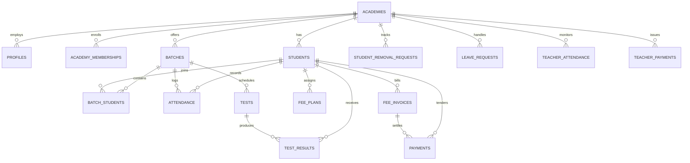

# EduTrack — Database Structure & Schema Reference

EduTrack uses PostgreSQL (hosted on Supabase) with Row-Level Security (RLS) enabled on all tables. Primary database time zone is `Asia/Karachi`.

---

## 1. Entity-Relationship Overview

---

## 2. Core Tables and Columns

### 1. `academies`
Stores tenant academy profiles and white-label branding tokens.
- `id` (UUID, PK)
- `name` (TEXT, NOT NULL)
- `academy_code` (TEXT UNIQUE, NOT NULL) — 10-char format `BTA-XXXXXX`
- `owner_id` (UUID, FK -> `profiles.id`)
- `address`, `phone`, `timezone` (TEXT)
- `fee_due_day` (SMALLINT, 1-28)
- `reminder_day` (SMALLINT, 1-28)
- `whatsapp_enabled` (BOOLEAN, default FALSE)
- `primary_color` (TEXT, default `#1565C0`)
- `secondary_color` (TEXT, default `#00838F`)
- `welcome_text` (TEXT)
- `subscription_plan` (TEXT, 'free' | 'pro' | 'premium')
- `feature_flags` (JSONB)
- `status` (TEXT, 'active' | 'suspended')
- `created_at`, `updated_at` (TIMESTAMPTZ)

### 2. `profiles`
Represents verified user identities linked to Supabase Auth (`auth.users`).
- `id` (UUID, PK -> `auth.users.id`)
- `role` (TEXT, 'owner' | 'teacher' | 'student' | 'parent' | 'staff')
- `platform_role` (TEXT, 'platform_admin' | 'member')
- `name` (TEXT, NOT NULL)
- `email` (TEXT)
- `phone_number` (TEXT)
- `academy_id` (UUID, FK -> `academies.id`)
- `account_status` (TEXT, 'active' | 'suspended')
- `must_change_password` (BOOLEAN, default FALSE)
- `created_at`, `updated_at` (TIMESTAMPTZ)

### 3. `academy_memberships`
Allows a single user to safely hold memberships across institutions without identity duplication.
- `id` (UUID, PK)
- `academy_id` (UUID, FK -> `academies.id`)
- `user_id` (UUID, FK -> `profiles.id`)
- `role` (TEXT, 'owner' | 'teacher' | 'student' | 'parent' | 'staff')
- `status` (TEXT, 'active' | 'suspended' | 'invited')
- `invitation_status` (TEXT, 'pending' | 'active' | 'disabled' | 'expired')
- `invited_by` (UUID, FK -> `profiles.id`)
- `phone` (TEXT)
- `created_at`, `updated_at` (TIMESTAMPTZ)
- *Constraint*: `UNIQUE (academy_id, user_id, role)`

### 4. `students`
Student academic records within a specific academy.
- `id` (UUID, PK)
- `academy_id` (UUID, FK -> `academies.id`)
- `name` (TEXT, NOT NULL)
- `class_name` (TEXT, NOT NULL)
- `cnic` (TEXT) — Masked in UI; used for private identity verification
- `email` (TEXT) — Verified student email for portal access
- `is_verified` (BOOLEAN, default FALSE)
- `linked_user_id` (UUID, FK -> `profiles.id`)
- `parent_name`, `parent_phone`, `parent_phone2`, `address` (TEXT)
- `status` (TEXT, 'active' | 'archived')
- `enrollment_date` (DATE)
- `created_at`, `updated_at` (TIMESTAMPTZ)

### 5. `batches` & `batch_students`
Classrooms, sections, and student enrollment mapping.
- `batches`: `id`, `academy_id`, `name`, `class_name`, `schedule`, `subject`, `teacher_id`, `teacher_name`, `student_count`, `status`.
- `batch_students`: `id`, `batch_id`, `student_id`, `joined_at`, `left_at`.

### 6. `attendance`
Session attendance registers with complete audit trail.
- `id` (UUID, PK)
- `student_id` (UUID, FK -> `students.id`)
- `batch_id` (UUID, FK -> `batches.id`)
- `attendance_date` (DATE)
- `status` (TEXT, 'present' | 'absent')
- `marked_by` (UUID, FK -> `profiles.id`)
- `corrected_by` (UUID, FK -> `profiles.id`)
- `correction_reason` (TEXT)
- `created_at`, `updated_at` (TIMESTAMPTZ)
- *Constraint*: `UNIQUE (student_id, batch_id, attendance_date)`

### 7. `tests` & `test_results`
Evaluations, exams, and student academic performance.
- `tests`: `id`, `batch_id`, `batch_name`, `subject`, `title`, `test_date`, `max_marks`, `created_by`.
- `test_results`: `id`, `test_id`, `student_id`, `student_name`, `marks`, `feedback`, `rank`, `percentage`.

### 8. `fee_plans`, `fee_invoices` & `payments`
Fee management, ledger calculations, and external payment proofs.
- `fee_plans`: `id`, `student_id`, `amount`, `billing_freq`, `due_day`, `active`, `effective_from`.
- `fee_invoices`: `id`, `student_id`, `billing_month`, `amount_due`, `amount_paid`, `due_date`, `status` ('unpaid' | 'partial' | 'paid' | 'overdue').
- `payments`: `id`, `invoice_id`, `student_id`, `amount`, `method` ('cash' | 'jazzcash' | 'easypaisa' | 'bank_transfer' | 'other'), `transaction_ref`, `verification_status` ('pending' | 'verified' | 'failed' | 'reversed'), `receipt_number`, `recorded_by`, `payment_type` ('payment' | 'reversal' | 'adjustment').

### 9. `student_removal_requests`
Teacher-initiated removal workflow requiring Principal approval.
- `id` (UUID, PK)
- `academy_id` (UUID, FK -> `academies.id`)
- `student_id` (UUID, FK -> `students.id`)
- `teacher_id` (UUID, FK -> `profiles.id`)
- `reason` (TEXT, NOT NULL)
- `status` (TEXT, 'pending' | 'approved' | 'rejected')
- `principal_notes` (TEXT)
- `reviewed_by` (UUID, FK -> `profiles.id`)
- `reviewed_at` (TIMESTAMPTZ)

### 10. `leave_requests`
Student-submitted leave requests with optional supporting attachments.
- `id` (UUID, PK)
- `academy_id` (UUID, FK -> `academies.id`)
- `student_id` (UUID, FK -> `students.id`)
- `start_date`, `end_date` (DATE)
- `reason` (TEXT)
- `proof_image_url` (TEXT)
- `status` (TEXT, 'pending' | 'approved' | 'rejected')
- `principal_notes` (TEXT)
- `reviewed_by` (UUID, FK -> `profiles.id`)

### 11. `teacher_attendance` & `teacher_payments`
Teacher operational tracking and owner-only compensation ledgers.
- `teacher_attendance`: `id`, `academy_id`, `teacher_id`, `attendance_date`, `status`, `lectures_scheduled`, `lectures_completed`, `marked_by`.
- `teacher_payments`: `id`, `academy_id`, `teacher_id`, `amount`, `payment_date`, `billing_month`, `method`, `reference`, `recorded_by`.

### 12. `academy_registration_requests`
Prospective academy onboarding applications reviewed by Platform Admin.
- `id` (UUID, PK)
- `academy_name`, `owner_name`, `owner_email`, `owner_phone`, `city`, `address`
- `status` ('pending' | 'approved' | 'rejected' | 'correction_requested')
- `admin_notes`, `reviewed_by`, `reviewed_at`

### 13. `audit_logs`
Immutable record of security-critical mutations.
- `id`, `actor_id`, `action`, `record_id`, `table_name`, `details`, `ip_address`, `created_at`.
